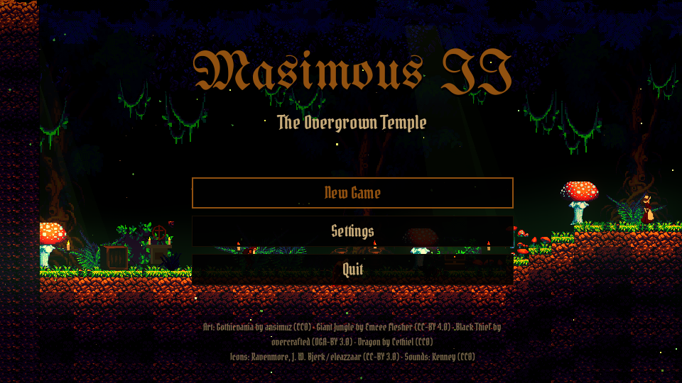
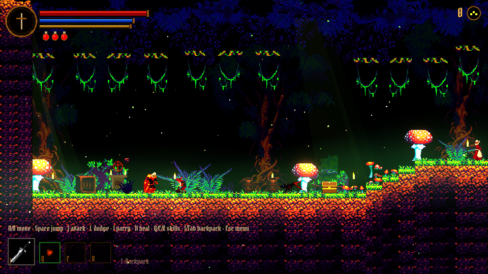
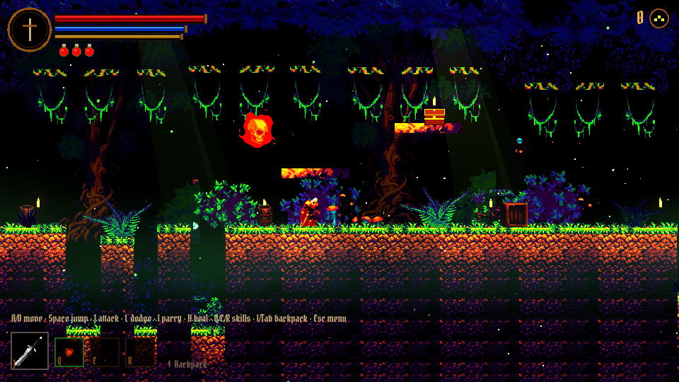
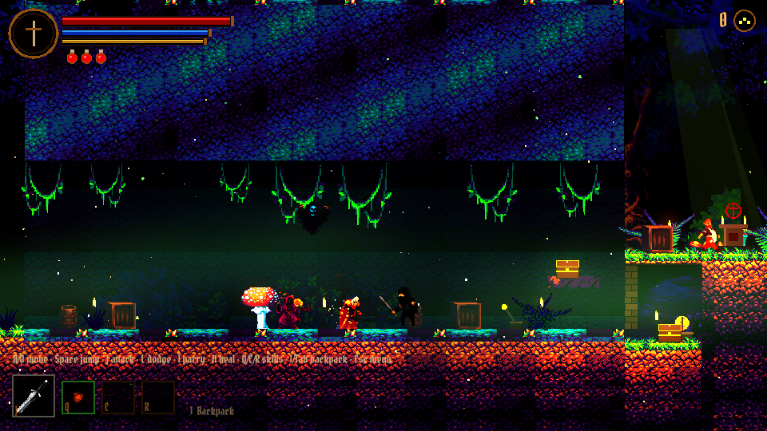
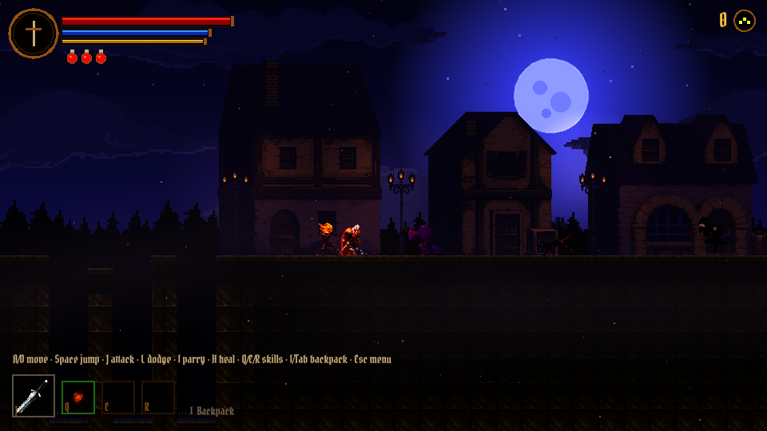
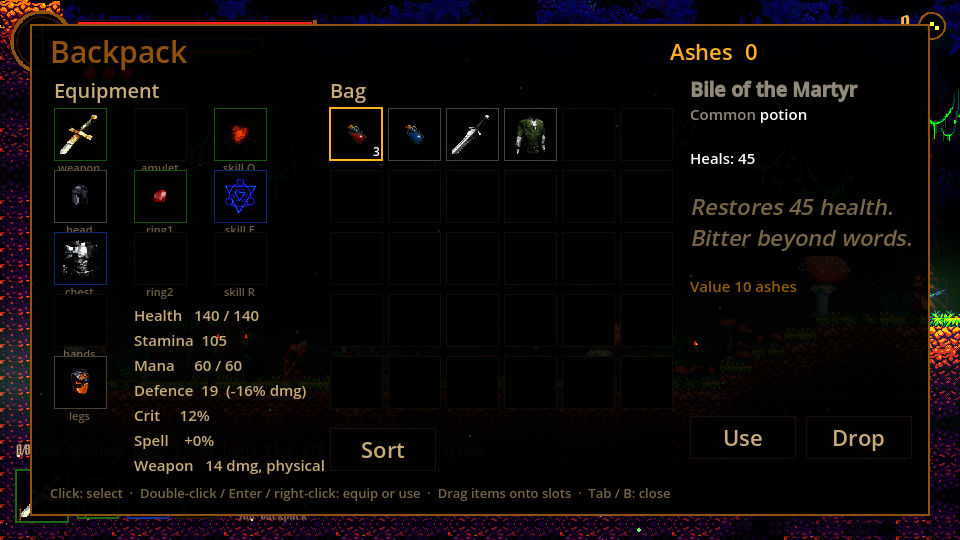
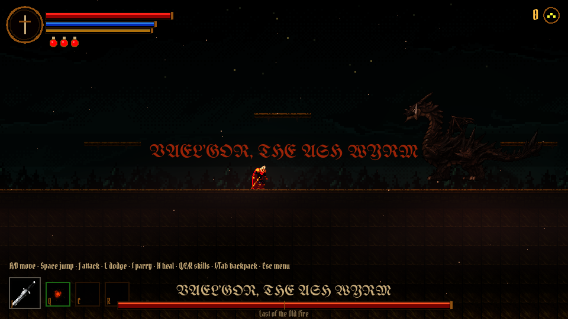

# MASIMOUS II

**A dark religious action-RPG metroidvania in HD pixel art — playable demo**

   

### ⬇ [Download the demo for Windows (zip, 83 MB)](https://github.com/CodTanium/MasimousII-demo/releases/latest/download/MasimousII-demo-v0.1.0-windows-x64.zip)

Unzip, then double-click **`MasimousII.exe`**.

## The demo

A nameless pilgrim wakes in **the Overgrown Temple**, a holy place the jungle swallowed long ago. Fight through ghouls, bandits, hounds and cultists, wake **Azrakel, the Pit Demon**, and break out under the moon onto **the Moonlit Ramparts**, where **Vael'gor, the Ash Wyrm** waits.

| | |
|---|---|
|  |  |
|  |  |
|  |  |

**What's in it**
- 2 areas, 4 shrines (rest = save), secret wall, shortcut, 6 treasure chests, breakable crates
- 10 monster types (melee, shield, archers, casters, flyers, hounds, 2 elites) and 2 bosses with phases
- 43 items: 12 weapons with their own speed, reach, stamina cost and element; 4 armour sets; rings, amulets, potions
- 4 skills (fireball, holy nova, blood dash, bone spikes), stamina and mana, parry and riposte, crits, element weaknesses
- Backpack with equipment, drag and drop, compare; loot drops with rarity; merchants (buy and sell), people to talk to
- Layered parallax jungle and night sky, god rays, fireflies, wind-swept plants
- Settings: window size, fullscreen, FPS cap, V-Sync, pixel-perfect scaling, brightness, glow, shake, vibration, volumes, key rebinding

## Controls

| Action | Keyboard | Xbox controller |
|---|---|---|
| Move | A / D | Left stick / D-pad |
| Jump | Space | A |
| Attack | J | X |
| Dodge | L / Shift | B |
| Parry | I | Y |
| Heal (flask) | H | LB |
| Skills | Q / E / R | RB / RT / LT |
| Talk / rest | W | Up |
| Backpack | Tab / B | View |
| Pause | Esc | Menu |

**Windows SmartScreen** may say "unknown publisher" (the demo is not code-signed): click **More info → Run anyway**.

## Credits

Game design and code: **CodTanium** (all rights reserved for the game code).
Art: *Gothicvania* by **ansimuz** (CC0) · *Space Merc Redux: Giant Jungle* by **Emcee Flesher** (CC-BY 4.0) · *The Black Thief* by **overcrafted** (OGA-BY 3.0) · *Dragon* by **Cethiel** (CC0) · icons by **Ravenmore** and **J. W. Bjerk (eleazzaar)** (CC-BY 3.0), **Blarumyrran** (CC0) · sounds by **Kenney** (CC0) · fonts under the SIL Open Font License.
Full list with links: [CREDITS.txt](CREDITS.txt). Made with [Godot](https://godotengine.org).
